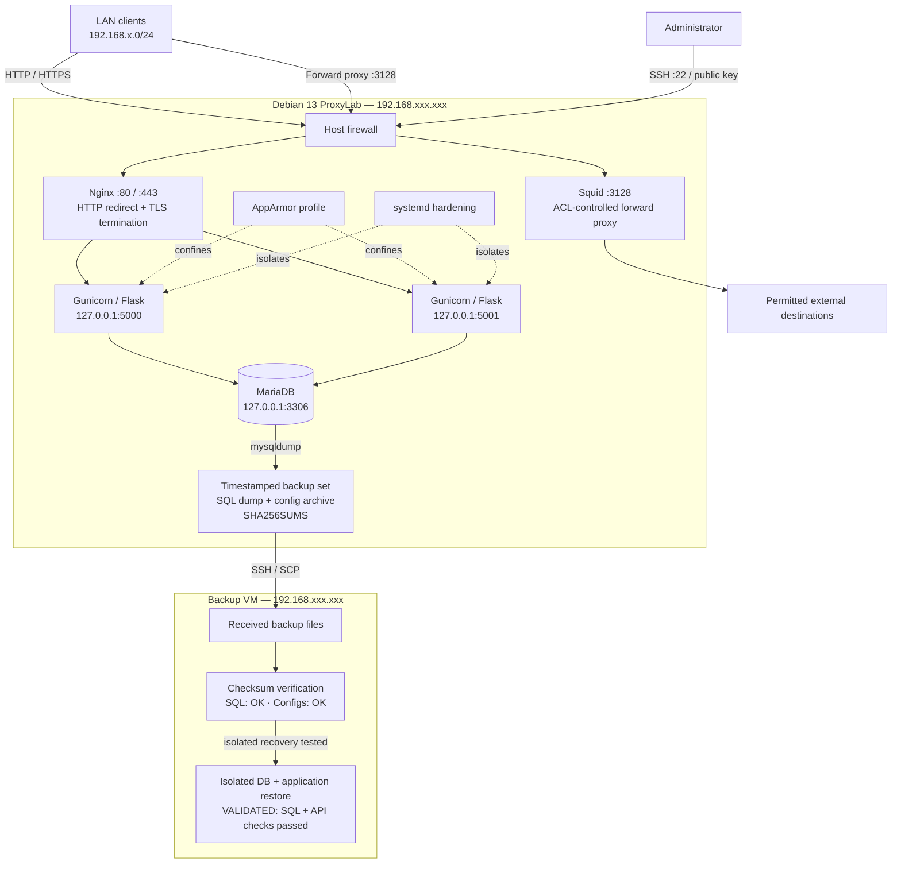

# ProxyLab — Reverse Proxy, Forward Proxy & Host Security Lab

A documented Debian 13 infrastructure lab using Nginx, Squid, Flask/Gunicorn, MariaDB, AppArmor, systemd hardening, firewall/SSH controls, and backup/restore workflows.

> **Evidence policy:** This repository separates recorded results from pending tests. Where a verbatim terminal transcript was not retained, the document labels the result as a recorded summary rather than recreating an exact transcript.

## Main architecture

The diagram below shows the end-to-end ProxyLab topology, including the Nginx reverse-proxy path, Squid forward proxy, MariaDB, host hardening, and the separate backup VM. Backup transfer, checksum verification, and isolated database/application restore validation are complete. Full-VM recovery and production cutover have not been tested. See the [full architecture documentation](docs/architecture/README.md) for detailed flows and test notes.

## Documentation map

- [Architecture diagrams](docs/architecture/README.md)
- [Ports and paths](docs/architecture/ports-and-paths.md)
- [Phase 01 — Foundation](docs/phases/01-foundation/README.md)
- [Phase 02 — MariaDB](docs/phases/02-database/README.md)
- [Phase 03 — Flask/Gunicorn](docs/phases/03-application/README.md)
- [Phase 04 — Nginx, TLS and load balancing](docs/phases/04-nginx-tls-load-balancing/README.md)
- [Phase 05 — Squid](docs/phases/05-squid-forward-proxy/README.md)
- [Phase 06 — SSH and firewall](docs/phases/06-host-access-controls/README.md)
- [Phase 07 — AppArmor](docs/phases/07-apparmor/README.md)
- [Phase 08 — systemd hardening](docs/phases/08-systemd-hardening/README.md)
- [Phase 09 — Backup and disaster recovery](docs/phases/09-backup-disaster-recovery/README.md)
- [Phase 10 — Validation and resilience](docs/phases/10-validation-resilience/README.md)
- [Command index](docs/COMMAND-INDEX.md)
- [Evidence and limitations](docs/EVIDENCE-AND-LIMITATIONS.md)
- [Security policy](SECURITY.md)

## Recorded lab environment

| Component | Recorded value |
|---|---|
| OS | Debian 13 |
| ProxyLab VM | 192.168.xxx.xxx |
| Gateway/DNS | 192.168.xxx.xxx |
| Nginx | TCP 80 and 443 |
| Backend 1 | 127.0.0.1:5000, proxylab.service |
| Backend 2 | 127.0.0.1:5001, proxylab-backend2.service |
| MariaDB | 127.0.0.1:3306, database proxylab |
| Squid | TCP 3128, intended for lab-subnet clients |
| Application | /opt/proxylab/app |
| Backup VM | 192.168.xxx.xxx |

These are lab values, not instructions to expose a VM publicly. Review all firewall and access-control rules before adapting.

## Status summary

**Demonstrated:** direct health checks for both backends; HTTPS `/health` and `/products` returned HTTP 200; Nginx responses showed both backend identities; controlled stop/restart tests for each backend completed successfully on 21 October 2026; when either one backend service was stopped, eight health requests and the products endpoint continued returning HTTP 200 through the surviving backend; after recovery, both services and ports were active and 10 final health requests reached both identities; AppArmor profile `proxylab-gunicorn` was observed in enforce mode; inspected systemd hardening settings; SQL/config archive transferred to a separate VM and checksums matched.

**Pending or requiring fresh evidence:** TLS hostname and trust-chain verification without `curl -k`; direct failure response from the stopped backend port (not captured during the failover test); fresh final Squid/firewall/SSH evidence; full-VM recovery, production cutover, and measured RTO/RPO (not part of the completed isolated restore test). The Nginx upstream has no active-health-check directive, so the completed tests demonstrate the observed behavior for controlled systemd stops rather than production-grade HA.

## Secret handling

Never commit `/etc/proxylab/proxylab.env`, real `DB_PASSWORD` values, TLS private keys, SSH private keys, database dumps, backup archives, Restic repository contents, tokens, or credentials. See [SECURITY.md](SECURITY.md).

## Expanded phase notes and security assessment

The phase landing pages link to deeper runbooks covering actual troubleshooting incidents, command references, diagrams, validation evidence, and assessment limitations.

- [Security assessment evidence](docs/phases/10-validation-resilience/security-assessment.md)
- [Security assessment index and architecture](docs/security-assessment/README.md)
- [Assessment matrix](docs/security-assessment/assessment-matrix.md)
- [Backend failure/recovery runbook with completed test evidence](docs/phases/10-validation-resilience/backend-failover-runbook.md)
- [Backup transfer troubleshooting](docs/phases/09-backup-disaster-recovery/transfer-troubleshooting.md)

The documentation distinguishes recorded results from proposed tests. It does not claim a test passed unless supporting output was retained.
