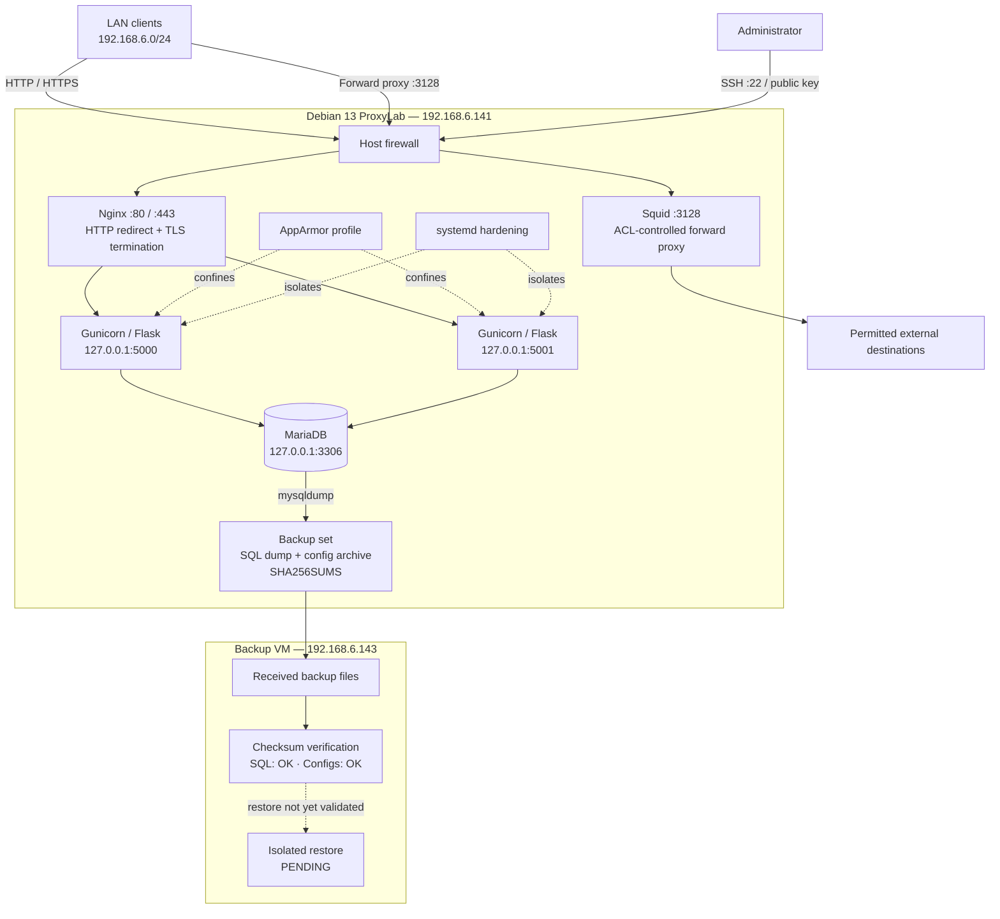
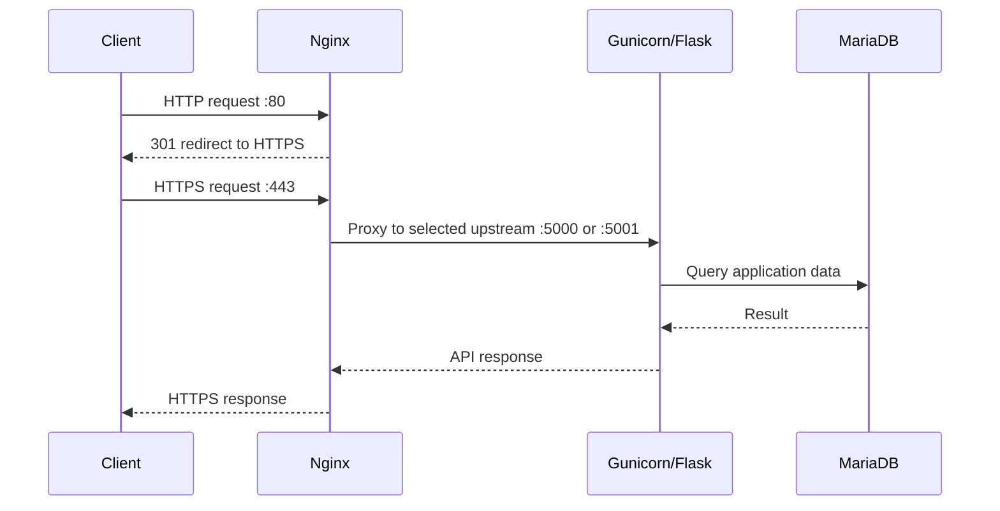
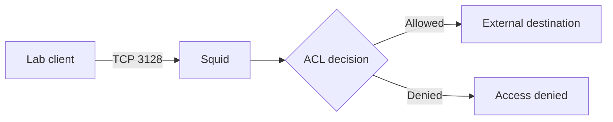
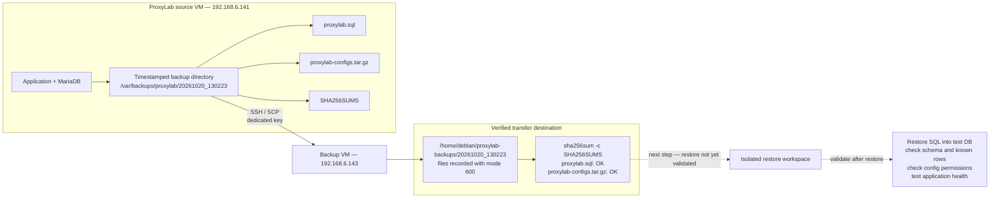

# Architecture

## End-to-end lab topology

This is the main system diagram, including the application path and the separately hosted backup/recovery path. The backup transfer and checksum verification are recorded; restore validation remains pending.

## Reverse proxy request flow

## Forward proxy flow

## Backup and recovery architecture

This detailed view expands the backup portion of the main topology. It represents the **recorded ProxyLab file-transfer path**, separate from the Restic repository used in the backup-platform lab. The solid path was transferred and checksum-verified; the dotted recovery path is planned and remains pending validation.

### Backup/recovery interpretation

- **Recorded:** backup artifacts were transferred from `192.168.6.141` to `192.168.6.143` over SSH/SCP using a dedicated key.
- **Recorded:** `sha256sum -c SHA256SUMS` returned `proxylab.sql: OK` and `proxylab-configs.tar.gz: OK`.
- **Destination caveat:** verified files were in `/home/debian/proxylab-backups/20261020_130223`, not `/backup/restic-repo`. Do not interpret this diagram as proof that the transferred files are Restic snapshots.
- **Pending:** restore the SQL dump to a separate test database, inspect/extract the config archive in an isolated directory, validate data and permissions, test application recovery, and record elapsed time. Dotted arrows denote planned work, not a passed recovery test.
- A checksum match proves integrity against the checksum manifest; it does not prove database consistency, application recovery, whole-VM recovery, immutability, or off-site protection.

## Boundaries

- Nginx is the client-facing reverse proxy; backends bind to loopback.
- Squid is a separate outbound forward-proxy path.
- MariaDB is recorded on loopback, not directly exposed to the LAN.
- AppArmor and systemd are distinct process-confinement/isolation layers.
- Diagrams describe documented configuration, not a live network scan.
