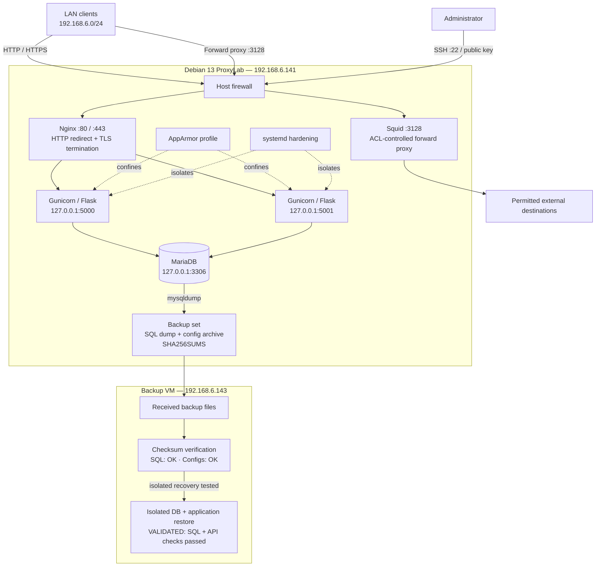
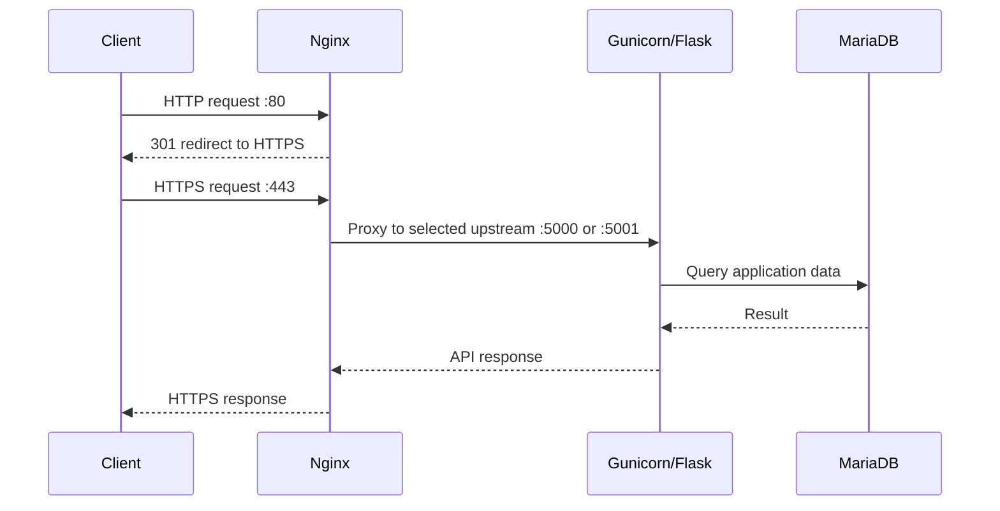
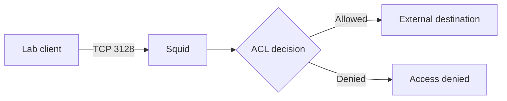
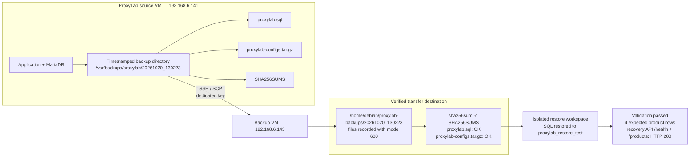

# Architecture

## End-to-end lab topology

This is the main system diagram, including the application path and the separately hosted backup/recovery path. Backup transfer, checksum verification, and isolated database/application restore validation are complete. Full-VM recovery and production cutover remain out of scope.

## Reverse proxy request flow

## Forward proxy flow

## Backup and recovery architecture

This detailed view expands the backup portion of the main topology. It represents the **recorded ProxyLab file-transfer path**, separate from the Restic repository used in the backup-platform lab. The backup transfer and checksum-verification path is recorded, and the isolated database/application recovery path has been validated.

### Backup/recovery interpretation

- **Recorded:** backup artifacts were transferred from `192.168.6.141` to `192.168.6.143` over SSH/SCP using a dedicated key.
- **Recorded:** `sha256sum -c SHA256SUMS` returned `proxylab.sql: OK` and `proxylab-configs.tar.gz: OK`.
- **Destination caveat:** verified files were in `/home/debian/proxylab-backups/20261020_130223`, not `/backup/restic-repo`. Do not interpret this diagram as proof that the transferred files are Restic snapshots.
- **Validated:** SQL was restored to the separate `proxylab_restore_test` database; the least-privilege recovery account read the four expected product rows; the isolated recovery API returned HTTP 200 for `/health` and `/products`.
- **Still not tested:** production cutover, full-VM recovery, and measured recovery duration/RTO/RPO. TLS trust/hostname validation is tracked separately.
- A checksum match proves integrity against the checksum manifest; it does not prove database consistency, application recovery, whole-VM recovery, immutability, or off-site protection.

## Backend resilience validation — 21 October 2026

The two-backend topology above was tested by stopping one systemd backend at a time and sending repeated HTTPS requests through Nginx.

- Stopping `proxylab.service` (backend 1, port 5000): 8/8 health requests returned HTTP 200 from backend 2; `/products` returned HTTP 200 with four products.
- Restarting backend 1: both services recovered; 8/8 health requests returned HTTP 200 and reached both backend identities.
- Stopping `proxylab-backend2.service` (backend 2, port 5001): 8/8 health requests returned HTTP 200 from backend 1; `/products` returned HTTP 200 with four products.
- Restarting backend 2: all core services were active, both backend ports were listening, `nginx -t` passed, and 10/10 final health requests reached both backend identities with HTTP 200.

These results demonstrate observed service-stop failover for the requests tested. They do not establish active upstream health checks or production-grade HA. Direct requests to the stopped port were not captured, and TLS trust/hostname verification remains pending because the HTTPS tests used `curl -k`.

Detailed commands and caveats: [Phase 10 backend failure/recovery runbook](../phases/10-validation-resilience/backend-failover-runbook.md).

## Boundaries

- Nginx is the client-facing reverse proxy; backends bind to loopback.
- Squid is a separate outbound forward-proxy path.
- MariaDB is recorded on loopback, not directly exposed to the LAN.
- AppArmor and systemd are distinct process-confinement/isolation layers.
- Diagrams describe documented configuration, not a live network scan.