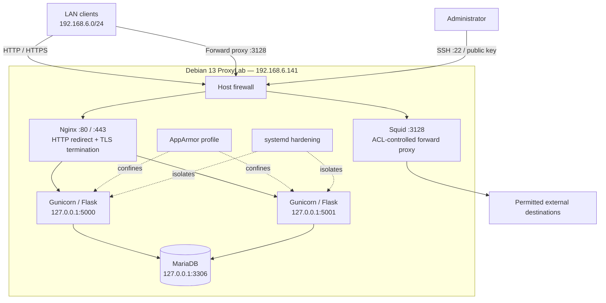
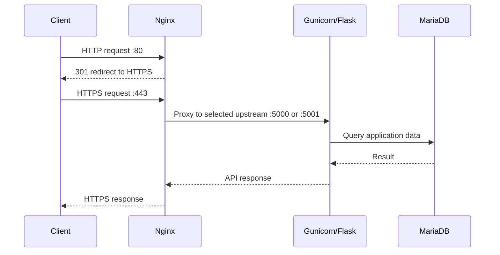
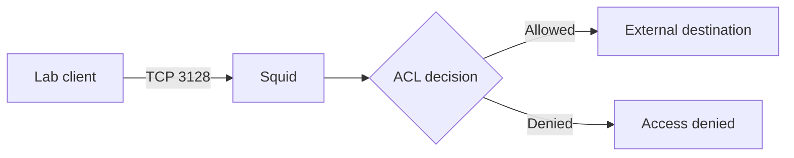

# Architecture

## End-to-end lab topology

## Reverse proxy request flow

## Forward proxy flow

## Boundaries
- Nginx is the client-facing reverse proxy; backends bind to loopback.
- Squid is a separate outbound forward-proxy path.
- MariaDB is recorded on loopback, not directly exposed to the LAN.
- AppArmor and systemd are distinct process-confinement/isolation layers.
- Diagrams describe documented configuration, not a live network scan.
