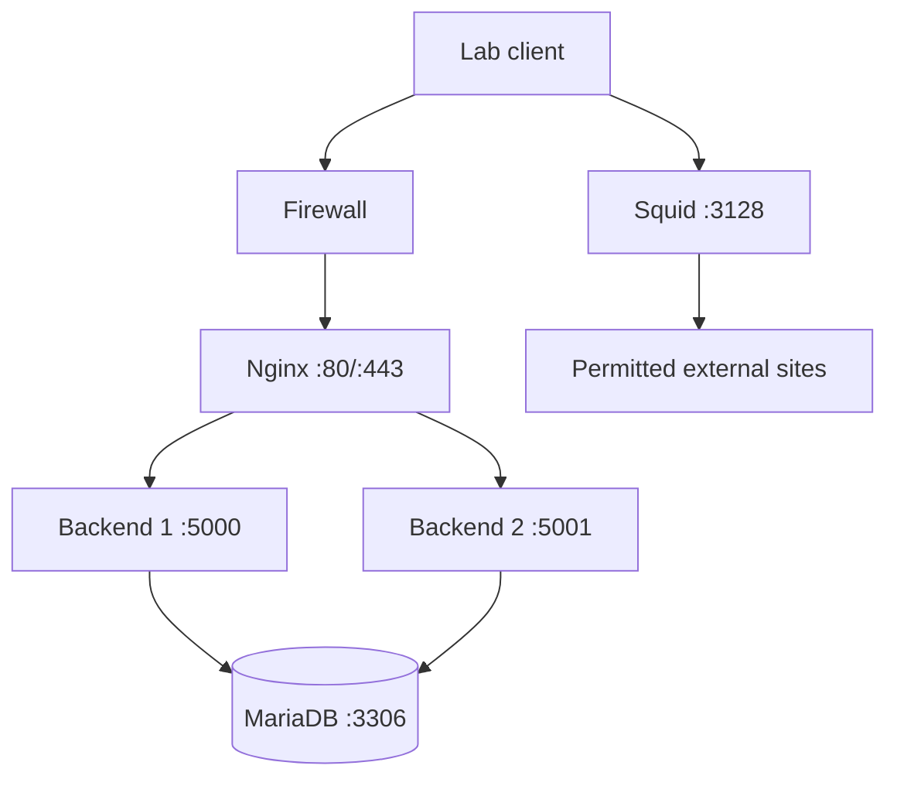

# Foundation phase — diagnostic checklist

## Architecture map



## Inventory

```bash
hostnamectl
ip -brief address
ip route
sudo ss -lntup
systemctl is-active nginx squid mariadb proxylab.service proxylab-backend2.service
```

Recorded lab values: Debian 13 VM 192.168.6.141/24; gateway/DNS 192.168.6.2; backup VM 192.168.6.143. Confirm the current addresses rather than assuming they have not changed.

## Troubleshooting order
1. **Name/address/routing:** check `ip -brief address` and `ip route`.
2. **Listener:** check `ss -lntup`; a service being active does not prove it listens on the expected port.
3. **Service:** `sudo systemctl status SERVICE --no-pager -l`.
4. **Logs:** `sudo journalctl -u SERVICE --since "10 minutes ago" --no-pager`.
5. **Config syntax:** validate the service configuration before reload.
6. **Functional test:** issue the original endpoint/proxy request and save actual output.

Expected trust boundaries: Gunicorn and MariaDB bind to loopback; Nginx is the inbound HTTP(S) path; Squid is the separate outbound proxy. Never expose backend ports or MariaDB to the LAN just to simplify a test.
