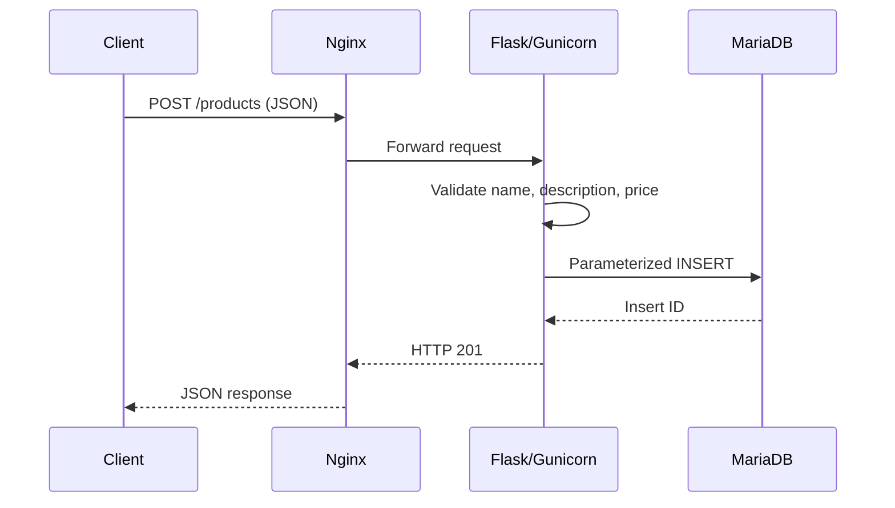

# API validation, secure error handling and incident records

## Recorded API surface
- GET /health
- GET /products
- GET /products/<id>
- POST /products

Both Gunicorn backends bind to loopback: backend 1 on 127.0.0.1:5000 and backend 2 on 127.0.0.1:5001.

## API flow



## Recorded input-validation outcomes (16 October 2026)
- Missing name, body `{"price":100}`: HTTP 400, `{"error":"A non-empty name is required"}`.
- Negative price, body `{"name":"Test Product","price":-10}`: HTTP 400, `{"error":"Price must be a finite positive number"}`.
- Malformed JSON, body `{"name":`: HTTP 400, `{"error":"A valid JSON object is required"}`.
- Valid temporary product: HTTP 201, returned ID 5.
- GET /products/5: HTTP 200; submitted name, description and price 10.50 matched.
- Cleanup query deleted one test row; the four seeded products remained.

## Database error-disclosure test

A mocked `mariadb.OperationalError("SIMULATED_DATABASE_FAILURE")` was injected into the Flask test client. The protected environment file was sourced in that isolated shell because systemd's EnvironmentFile is not inherited by a manually launched Python process. The real password was not printed.

Observed:
```text
HTTP status: 500
Response body: {"error":"Internal server error"}
Sensitive test detail exposed: False
```

This was a mocked application error test. A separate live MariaDB-stop experiment stopped both backend units due to `Requires=mariadb.service`; Nginx returned HTTP 502. Services were started again and API checks returned HTTP 200. Do not confuse the generic 500 test with the dependency-driven 502 event.

## Safe repeatable checks

```bash
cd /opt/proxylab/app
/opt/proxylab/app/venv/bin/python -m py_compile app.py
curl -k -sS -w '\nHTTP %{http_code}\n' https://127.0.0.1/health
curl -k -sS -w '\nHTTP %{http_code}\n' https://127.0.0.1/products
curl -k -sS -w '\nHTTP %{http_code}\n' https://127.0.0.1/products/99999
```

The recorded missing-product response was `{"error":"Product not found"}`, HTTP 404. `curl -k` bypasses certificate validation. Avoid destructive POST/DELETE tests against live data; use temporary test records and clean them up.
