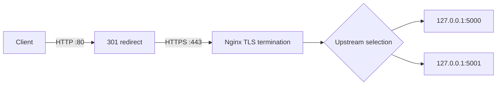

# Nginx, TLS and upstream diagnostics

## Recorded upstream

```nginx
upstream proxylab_backend {
    server 127.0.0.1:5000;
    server 127.0.0.1:5001;
}
```

The HTTP listener on port 80 redirects to HTTPS. The TLS listener on port 443 uses the certificate at `/etc/nginx/ssl/proxylab.crt`, the private key at `/etc/nginx/ssl/proxylab.key`, and TLS protocols 1.2 and 1.3. Requests are proxied with Host, X-Real-IP, X-Forwarded-For and X-Forwarded-Proto headers.

## Request flow



## Inspect and validate

```bash
sudo sed -n '1,160p' /etc/nginx/sites-enabled/proxylab
sudo nginx -t
sudo ss -lntp | grep -E ':(80|443)\b'
sudo tail -n 50 /var/log/nginx/proxylab_error.log
sudo tail -n 30 /var/log/nginx/proxylab_access.log
```

Do not reload if `nginx -t` fails. Preserve the exact syntax error and included filename.

## Recorded response interpretation
- HTTP / returned 301, consistent with HTTP-to-HTTPS redirect.
- HTTPS / returned 404 because no homepage route is defined in this API.
- HTTPS /health and /products returned HTTP 200 in recorded tests.
- A MariaDB stop experiment caused backend services to stop through their systemd dependency and Nginx returned HTTP 502.

## Investigating 502
1. Check `systemctl is-active proxylab.service proxylab-backend2.service mariadb`.
2. Check listeners with `sudo ss -lntp | grep -E ':(5000|5001|3306)\b'`.
3. Test each backend directly.
4. Inspect both backend journals.
5. Inspect Nginx error logs for the exact upstream and error (connection refused, timeout, etc.).

## TLS caveat
The lab certificate was recorded as self-signed with CN 192.168.6.141. Requests made to `https://127.0.0.1` with `curl -k` do not validate trust or hostname. A proper validation requires the correct certificate SAN/hostname and trusted CA, tested without `-k`.
