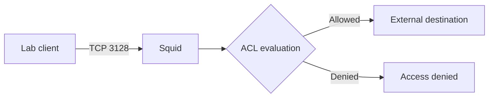

# Squid troubleshooting and security checks

## Traffic path



## Commands

```bash
sudo systemctl status squid --no-pager -l
sudo ss -lntp | grep ':3128' || true
sudo grep -nE '^[[:space:]]*(acl|http_access|http_port)' /etc/squid/squid.conf
sudo squid -k parse
sudo tail -n 80 /var/log/squid/access.log
```

The assessment sessions inspected service status, listener and ACL directives, but the complete raw output is not retained in the assessment page. Re-run these commands for fresh evidence rather than inventing exact output.

## Troubleshooting matrix

| Symptom | Check | Action |
|---|---|---|
| Connection refused | Service and listener | Start/repair service only after reading its journal |
| Access denied | ACL order and access log | Identify which ACL matched; preserve intended deny rules |
| Timeout | Route, firewall and logs | Separate network path failures from ACL denials |
| Proxy exposed too broadly | Listener bind and firewall | Restrict source subnet; never create an open proxy |
| Config reload fails | `sudo squid -k parse` | Fix reported syntax before reload |

Test one permitted destination and one intentionally denied destination from an authorized client. Record the command, response, client source and relevant access-log entry.
