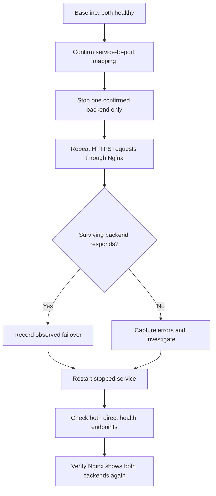

# Phase 10 — Security Validation and Resilience

## Recorded API checks
```bash
echo "=== Backend 1 ==="
curl --max-time 5 -sS http://127.0.0.1:5000/health
echo
echo "=== Backend 2 ==="
curl --max-time 5 -sS http://127.0.0.1:5001/health
echo
echo "=== HTTPS through Nginx ==="
for i in $(seq 1 6); do curl -k --max-time 5 -sS https://127.0.0.1/health || echo "FAILED"; echo; done
echo "=== Recent service errors ==="
sudo journalctl -u proxylab.service --since "10 minutes ago" --no-pager -p err
```

Recorded outputs: direct backends returned their healthy JSON with HTTP 200; six HTTPS requests succeeded and alternated backend identities; recent error-priority journal query returned '-- No entries --'. The HTTPS requests used -k, so TLS trust was not checked.

## Planned controlled failover — NOT YET EXECUTED



Read-only discovery:
```bash
sudo ss -lntp | grep -E '127.0.0.1:(5000|5001)' || true
systemctl list-units --type=service --all --no-legend | grep -Ei 'proxylab|gunicorn' || true
sudo systemctl cat proxylab.service
```

Safety: test only in the lab during a quiet period; keep SSH open; confirm mapping first; do not stop Nginx, MariaDB or the VM; restart the stopped backend promptly; preserve exact output. Do not describe passive behavior as active health checking or production-grade HA.

Acceptance checklist:
- [ ] Confirm stopped backend is unavailable directly.
- [ ] Repeated Nginx HTTPS requests use the surviving backend, if actual behavior supports it.
- [ ] Stopped service restarts successfully.
- [ ] Both direct health checks pass after recovery.
- [ ] Nginx shows both identities again.
- [ ] Actual output and limitations are documented.

TLS trust/hostname verification is also pending; test without -k using the intended hostname and trusted CA.

## Detailed notes
- [Security assessment evidence, commands and results](security-assessment.md)
- [Controlled backend failure/recovery runbook — planned, not yet executed](backend-failover-runbook.md)
