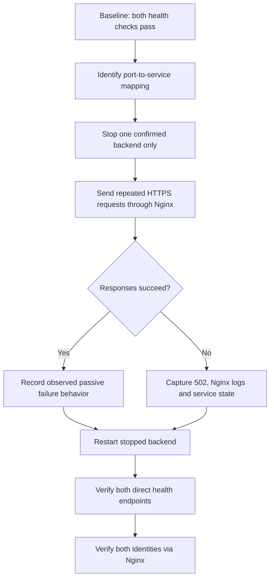

# Phase 10B — Controlled backend failure and recovery

**Status: executed successfully on 21 October 2026 for both single-backend failure directions.** The actual results are recorded below; the test does not establish active upstream health checks or production-grade HA.

## Flow



## Safety
- Run only in the lab during a quiet period; keep SSH open.
- Do not stop Nginx, MariaDB or the VM.
- Confirm the exact process/service owning port 5000 or 5001 before stopping anything.
- Restart the selected service promptly after the test.
- The inspected Nginx upstream showed no active health-check directive. Document actual passive failure behavior, not production HA.

## 1. Read-only discovery

```bash
echo "=== Services listening on backend ports ==="
sudo ss -lntp | grep -E '127\.0\.0\.1:(5000|5001)' || true
echo
echo "=== Candidate services ==="
systemctl list-units --type=service --all --no-legend | grep -Ei 'proxylab|gunicorn' || true
echo
echo "=== Backend 1 ==="
sudo systemctl cat proxylab.service
echo
echo "=== Backend 2 ==="
sudo systemctl cat proxylab-backend2.service
```

## 2. Baseline

```bash
curl --max-time 5 -sS -w '\nHTTP %{http_code}\n' http://127.0.0.1:5000/health
curl --max-time 5 -sS -w '\nHTTP %{http_code}\n' http://127.0.0.1:5001/health
for i in $(seq 1 6); do curl -k --max-time 5 -sS https://127.0.0.1/health; echo; done
```

Save actual output. `-k` skips certificate validation.

## 3. Stop one confirmed service and test

Only after mapping is confirmed, set SERVICE to the actual service name. The following is an example for backend 2; do not use blindly if the live mapping differs.

```bash
SERVICE=proxylab-backend2.service
sudo systemctl stop "$SERVICE"
systemctl is-active "$SERVICE" || true
curl --max-time 3 -sS -w '\nHTTP %{http_code}\n' http://127.0.0.1:5001/health || true
for i in $(seq 1 12); do
  printf 'Request %02d: ' "$i"
  curl -k --max-time 5 -sS -w ' HTTP %{http_code}\n' https://127.0.0.1/health || echo "REQUEST FAILED"
done
sudo tail -n 50 /var/log/nginx/proxylab_error.log
```

Adjust the direct port test to match the backend actually stopped. Record every response exactly.

## 4. Restore and verify

```bash
sudo systemctl start "$SERVICE"
systemctl is-active "$SERVICE"
curl --max-time 5 -sS -w '\nHTTP %{http_code}\n' http://127.0.0.1:5000/health
curl --max-time 5 -sS -w '\nHTTP %{http_code}\n' http://127.0.0.1:5001/health
for i in $(seq 1 6); do curl -k --max-time 5 -sS https://127.0.0.1/health; echo; done
sudo journalctl -u "$SERVICE" --since "10 minutes ago" --no-pager
```

## Acceptance criteria
- [x] Baseline checks pass for both backends.
- [ ] Stopped backend is unavailable directly (direct fault response was not captured).
- [x] Nginx behavior during both service-stop faults was recorded: 8/8 HTTP 200 health responses from the surviving backend in each direction.
- [x] Each stopped service started successfully.
- [x] Final validation confirmed both services active and both ports 5000/5001 listening.
- [x] Final Nginx checks showed both backend identities; 10/10 health requests returned HTTP 200.
- [x] Products endpoint returned HTTP 200 and the four expected products during both failure scenarios and final validation.
- [ ] TLS trust/hostname verification without `curl -k` remains pending.

## 5. Executed test evidence — 21 October 2026

### Baseline
- Nginx and MariaDB were active.
- `proxylab.service` (backend 1) and `proxylab-backend2.service` (backend 2) were active.
- Ports 443, 5000 and 5001 were listening; Nginx upstream contained `127.0.0.1:5000` and `127.0.0.1:5001`.
- HTTPS `/health` and `/products` returned HTTP 200; `/products` contained Laptop, Keyboard, Mouse and Monitor.
- `sudo nginx -t` passed.

### Fault A — backend 1 stopped
Commands executed included `sudo systemctl stop proxylab.service`, repeated HTTPS health checks (8 requests), a products check, backend 2 service/listener checks, and a tail of `/var/log/nginx/error.log`.

Observed:
- `proxylab.service` became `inactive`; `proxylab-backend2.service` stayed `active`.
- All 8 health requests returned HTTP 200 and `"backend":"backend-2"`.
- `/products` returned HTTP 200 and all four products.
- Port 5001 remained listening.

### Recovery A — backend 1 restarted
Commands included `sudo systemctl start proxylab.service`, service status checks, repeated HTTPS health checks (8 requests), products check and `journalctl`.

Observed:
- Both backend services reported `active`.
- All 8 health requests returned HTTP 200 and showed both backend identities.
- `/products` returned HTTP 200 and all four products.
- Journal showed Gunicorn starting and listening at `127.0.0.1:5000`.
- One intermediate listener grep showed only port 5001; the final validation later confirmed both ports listening.

### Fault B — backend 2 stopped
Commands executed included `sudo systemctl stop proxylab-backend2.service`, repeated HTTPS health checks (8 requests), a products check, backend 1 listener check and a tail of `/var/log/nginx/error.log`.

Observed:
- `proxylab-backend2.service` became `inactive`; `proxylab.service` stayed `active`.
- All 8 health requests returned HTTP 200 and `"backend":"backend-1"`.
- `/products` returned HTTP 200 and all four products.
- Port 5000 remained listening.

### Recovery B and final state
Commands included `sudo systemctl start proxylab-backend2.service`, status checks for Nginx, MariaDB and both backends, listener checks, `sudo nginx -t`, 10 health requests, a products check and backend 2 journal review.

Observed:
- Nginx, MariaDB, `proxylab.service` and `proxylab-backend2.service` all reported `active`.
- Both `127.0.0.1:5000` and `127.0.0.1:5001` were listening.
- `nginx -t` succeeded.
- All 10 health requests returned HTTP 200 and identified both backend 1 and backend 2.
- `/products` returned HTTP 200 with all four expected products.
- Backend 2 journal showed Gunicorn listening at `127.0.0.1:5001` and workers booting.

### Caveats and troubleshooting
- The generic `/var/log/nginx/error.log` check printed no lines. The virtual host specifies `/var/log/nginx/proxylab_error.log`; use the configured path for future diagnostics.
- Direct requests to the stopped backend were not captured, so the exact direct-failure response is not claimed as verified.
- `curl -k` skips certificate validation. TLS trust and hostname verification remain pending.
- The Nginx upstream configuration has no active-health-check directive. These tests establish observed behavior for controlled systemd stops, not every crash scenario or production-grade HA.
- No formal RTO/RPO or measured recovery duration was recorded.