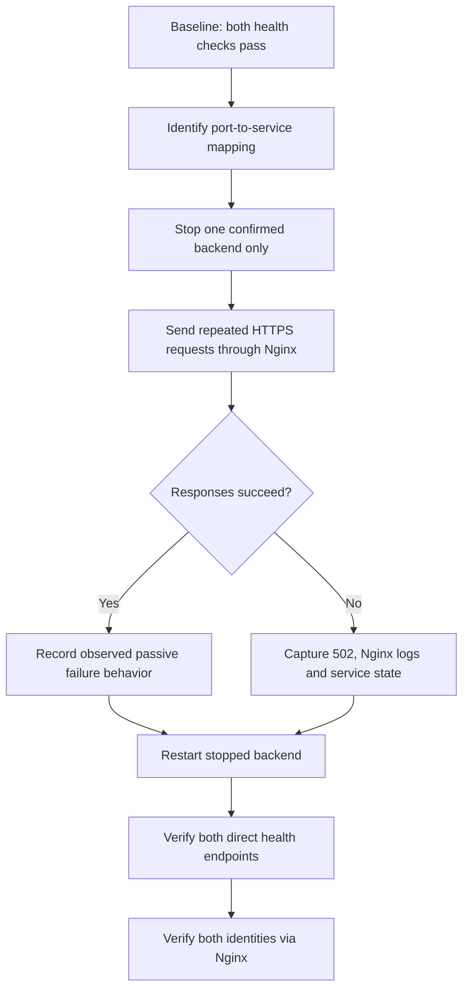

# Phase 10B — Controlled backend failure and recovery

**Status: planned; do not mark passed until actually executed.**

## Flow



## Safety
- Run only in the lab during a quiet period; keep SSH open.
- Do not stop Nginx, MariaDB or the VM.
- Confirm the exact process/service owning port 5000 or 5001 before stopping anything.
- Restart the selected service promptly after the test.
- The inspected Nginx upstream showed no active health-check directive. Document actual passive failure behavior, not production HA.

## 1. Read-only discovery

```bash
echo "=== Services listening on backend ports ==="
sudo ss -lntp | grep -E '127\.0\.0\.1:(5000|5001)' || true
echo
echo "=== Candidate services ==="
systemctl list-units --type=service --all --no-legend | grep -Ei 'proxylab|gunicorn' || true
echo
echo "=== Backend 1 ==="
sudo systemctl cat proxylab.service
echo
echo "=== Backend 2 ==="
sudo systemctl cat proxylab-backend2.service
```

## 2. Baseline

```bash
curl --max-time 5 -sS -w '\nHTTP %{http_code}\n' http://127.0.0.1:5000/health
curl --max-time 5 -sS -w '\nHTTP %{http_code}\n' http://127.0.0.1:5001/health
for i in $(seq 1 6); do curl -k --max-time 5 -sS https://127.0.0.1/health; echo; done
```

Save actual output. `-k` skips certificate validation.

## 3. Stop one confirmed service and test

Only after mapping is confirmed, set SERVICE to the actual service name. The following is an example for backend 2; do not use blindly if the live mapping differs.

```bash
SERVICE=proxylab-backend2.service
sudo systemctl stop "$SERVICE"
systemctl is-active "$SERVICE" || true
curl --max-time 3 -sS -w '\nHTTP %{http_code}\n' http://127.0.0.1:5001/health || true
for i in $(seq 1 12); do
  printf 'Request %02d: ' "$i"
  curl -k --max-time 5 -sS -w ' HTTP %{http_code}\n' https://127.0.0.1/health || echo "REQUEST FAILED"
done
sudo tail -n 50 /var/log/nginx/proxylab_error.log
```

Adjust the direct port test to match the backend actually stopped. Record every response exactly.

## 4. Restore and verify

```bash
sudo systemctl start "$SERVICE"
systemctl is-active "$SERVICE"
curl --max-time 5 -sS -w '\nHTTP %{http_code}\n' http://127.0.0.1:5000/health
curl --max-time 5 -sS -w '\nHTTP %{http_code}\n' http://127.0.0.1:5001/health
for i in $(seq 1 6); do curl -k --max-time 5 -sS https://127.0.0.1/health; echo; done
sudo journalctl -u "$SERVICE" --since "10 minutes ago" --no-pager
```

## Acceptance criteria
- [ ] Baseline checks pass for both backends.
- [ ] Stopped backend is unavailable directly.
- [ ] Nginx behavior during the fault is recorded exactly.
- [ ] Stopped service starts successfully.
- [ ] Both direct health checks pass after recovery.
- [ ] Both identities return through Nginx again.
- [ ] Actual status codes, logs, timing and limitations are saved.
