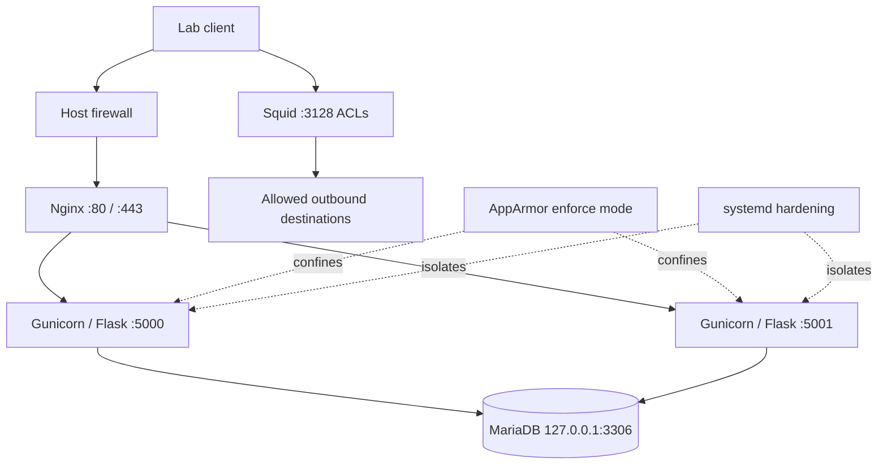

# Phase 10A — Security assessment and validation evidence

This report consolidates the ProxyLab Notion assessment. Historical outputs are marked as such; missing transcripts are not reconstructed as exact evidence.

## Architecture



## 1. Nginx upstream and TLS configuration

Command recorded:
```bash
sudo sed -n '1,45p' /etc/nginx/sites-enabled/proxylab
```

Observed upstream:
```nginx
upstream proxylab_backend {
    server 127.0.0.1:5000;
    server 127.0.0.1:5001;
}
```

The site redirects port 80 to HTTPS, uses TLS 1.2/1.3, loads its certificate/key from `/etc/nginx/ssl/`, and proxies to the upstream with Host, X-Real-IP, X-Forwarded-For and X-Forwarded-Proto headers. The inspected block showed default round-robin upstreams, not an active health-check directive.

Validate current config:
```bash
sudo nginx -t
sudo ss -lntp | grep -E ':(80|443)\b'
```

## 2. Recorded 20-request load-balancing test

```bash
set -u
for i in $(seq 1 20); do
  printf 'Request %02d: ' "$i"
  curl -k --max-time 5 -sS https://127.0.0.1/health || echo "REQUEST FAILED"
  echo
done
```

All 20 requests returned healthy JSON and both backend identities appeared. The recorded sequence included backend-1 on both requests 11 and 12, so this test was not perfectly alternating. A later six-request test alternated backend-1/backend-2. The `-k` flag disables certificate verification.

## 3. AppArmor denial investigation

Historical command:
```bash
sudo journalctl -k --since "5 minutes ago" --no-pager |
  grep -i 'apparmor="DENIED"' ||
  echo "No recent AppArmor denials found"
```

Historical output on 20 October 2026:
```text
apparmor="DENIED" operation="getattr" class="file" info="Failed name lookup - disconnected path" error=-13 profile="proxylab-gunicorn" name="dev/null" pid=2994 comm="gunicorn" requested_mask="r" denied_mask="r"
apparmor="DENIED" operation="getattr" class="file" info="Failed name lookup - disconnected path" error=-13 profile="proxylab-gunicorn" name="dev/null" pid=2994 comm="gunicorn" requested_mask="r" denied_mask="r"
```

Profile inspection and enforcement commands:
```bash
sudo grep -Rnl 'profile proxylab-gunicorn' /etc/apparmor.d 2>/dev/null || true
sudo grep -nE '/dev/null|abstractions/base' /etc/apparmor.d/abstractions/base
sudo apparmor_parser -Q -T /etc/apparmor.d/opt.proxylab.app.venv.bin.gunicorn
sudo aa-status | grep -A 2 -B 2 'proxylab-gunicorn'
PID=$(systemctl show proxylab.service -p MainPID --value)
echo "Gunicorn PID: $PID"
sudo ls -l "/proc/$PID/root/dev/null"
sudo journalctl -k --since "10 minutes ago" --no-pager | grep 'apparmor="DENIED"' | tail -10
```

The base abstraction contained `/dev/null rw,`; the parser command returned without output/error, and `-Q` checks without loading the profile. Later status showed six processes in enforce mode and zero in complain mode; a later 10-minute query had no matching denial output. The exact cause of the historical denial was not conclusively established. Do not disable AppArmor or add broad permissions just to silence old logs.

## 4. systemd hardening and Gunicorn temp-directory incident

Commands:
```bash
sudo systemctl cat proxylab.service
sudo systemctl status proxylab.service --no-pager -l
sudo systemctl show proxylab.service -p ExecStart -p PrivateTmp -p PrivateDevices -p ProtectSystem -p ReadWritePaths
sudo systemd-analyze security proxylab.service --no-pager | tail -n 3
```

Recorded security summary:
```text
✓ UMask=  Files created by service are accessible only by service's own user by default
→ Overall exposure level for proxylab.service: 4.6 OK
```

Historical failure:
```text
FileNotFoundError: [Errno 2] No usable temporary directory found in ['/tmp', '/var/tmp', '/usr/tmp', '/opt/proxylab/app']
proxylab.service: Main process exited, code=exited, status=255/EXCEPTION
proxylab.service: Failed with result 'exit-code'.
```

Recorded remediation: create `/home/debian/.gunicorn/tmp`, set owner `debian:debian`, mode 700, and pass `--worker-tmp-dir /home/debian/.gunicorn/tmp` to Gunicorn through a systemd drop-in. Reload systemd, restart the service, then test the direct health endpoint. After the fix, backend 1 was active and returned HTTP 200. The directory check showed owner-only permissions.

Configuration caveat: an earlier drop-in showed `PrivateTmp=yes`; later effective checks recorded `PrivateTmp=no` for both backends. Recheck current effective settings and do not claim PrivateTmp isolation when the effective value is no.

## 5. Final recorded API/service validation

The following test returned healthy JSON for direct backend checks, then six successful HTTPS health responses alternating between both identities:
```bash
curl --max-time 5 -sS http://127.0.0.1:5000/health
curl --max-time 5 -sS http://127.0.0.1:5001/health
for i in $(seq 1 6); do curl -k --max-time 5 -sS https://127.0.0.1/health; echo; done
sudo journalctl -u proxylab.service --since "10 minutes ago" --no-pager -p err
```

Recorded recent error-priority journal result: `-- No entries --`. This is a time-windowed result, not a guarantee of no errors outside that window.

Post-reboot notes recorded all five services active: `proxylab.service`, `proxylab-backend2.service`, `nginx`, `mariadb`, and `squid`. HTTPS `/health` and `/products` returned HTTP 200; products contained the four expected seeded records. The subsequent AppArmor audit showed enforce mode and no matching DENIED entries in the last 10 minutes.

## Assessment matrix

| Control | Recorded result | Limitation / next step |
|---|---|---|
| Nginx upstream | Two loopback upstreams configured | Re-run nginx -t for fresh evidence |
| HTTPS health/products | HTTP 200 | Historical tests used curl -k; trust/hostname pending |
| Load balancing | Both identities observed | Controlled backend failure/recovery completed for the tested scenarios |
| AppArmor | Enforce mode observed | Historical /dev/null denial root cause unresolved |
| systemd hardening | Inspected; score 4.6 at one point | Recheck both effective units; PrivateTmp later no |
| Squid/firewall/SSH | Earlier inspection reported | Capture fresh complete output |
| Backup and isolated restore | SHA-256 checksums matched; isolated SQL restore and API checks passed | Full-VM recovery and production cutover not tested |
| Backend failover | Controlled stop/restart of both backends passed for tested scenarios | Direct stopped-port response not captured; no active upstream health checks |
