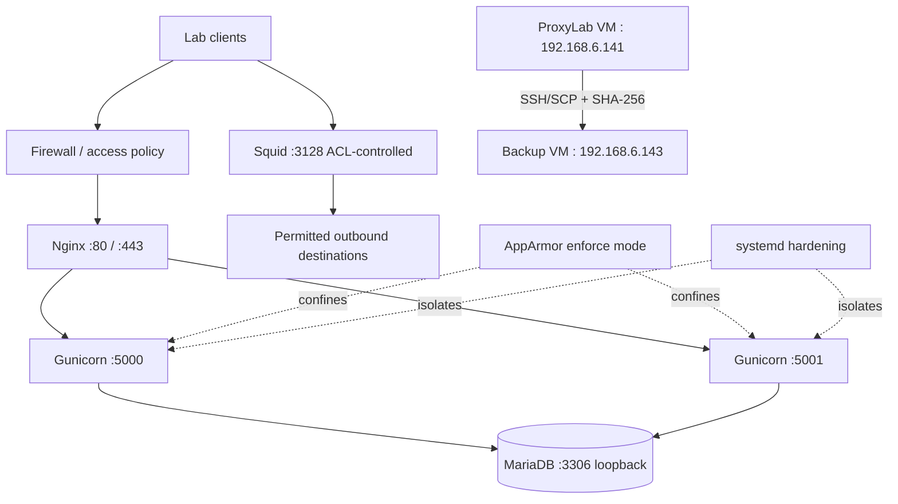

# ProxyLab Security Assessment

This directory consolidates the security controls, validation evidence, troubleshooting notes and remaining work for the Debian 13 ProxyLab lab. It is based on the Notion page **ProxyLab Security Assessment & Validation** and earlier project records. Historical evidence is labelled as such; missing terminal output is not invented.

## Documents

- [Detailed assessment evidence](../phases/10-validation-resilience/security-assessment.md) — Nginx/TLS, load balancing, AppArmor, systemd, health checks and observed outputs.
- [Assessment matrix](assessment-matrix.md) — status, evidence limitations and next actions.
- [Network, Squid, firewall and SSH review](network-access-review.md) — intended exposure and commands for fresh evidence.
- [Backup integrity and disaster recovery](backup-recovery-security.md) — recorded transfer issue, checksum results and restore limits.
- [Backend failure/recovery runbook](../phases/10-validation-resilience/backend-failover-runbook.md) — controlled backend stop/restart tests completed; see recorded scope and limitations.

## Security boundaries

## Important caveats

1. HTTPS response checks used `curl -k`, so certificate trust and hostname verification remain unproven.
2. Controlled backend failure/recovery was executed for both single-backend service-stop scenarios; see the runbook for limitations.
3. Backup checksums matched after transfer, and isolated database/application recovery was subsequently validated. Full-VM recovery and production cutover remain untested.
4. Squid, firewall and SSH require fresh full outputs for final sign-off.
5. Never commit environment secrets, TLS private keys, SSH private keys, database dumps, backup archives or Restic repository contents.
