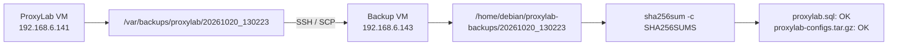

# Backup integrity and disaster-recovery assessment

## Transfer flow



## Recorded transfer incident
The first copy attempt did not complete; the remote directory was empty. Source files were `root:root`, mode 600, so the normal `debian` account could not read them directly. Temporary copies were staged under `/home/debian/proxylab-transfer/`, owner `debian:debian`, mode 600. SCP was retried with the dedicated SSH key and `IdentitiesOnly=yes`. After successful remote verification, temporary staging files were removed and the original source backup remained intact.

## Recorded verification command

```bash
ssh -i /home/debian/.ssh/proxylab_backup_ed25519 \
  -o IdentitiesOnly=yes \
  debian@192.168.6.143 \
  "cd /home/debian/proxylab-backups/20261020_130223 && sha256sum -c SHA256SUMS && ls -lh"
```

Observed:
```text
proxylab.sql: OK
proxylab-configs.tar.gz: OK
```

The remote listing contained the SQL dump, configuration archive and checksum manifest; recorded files had mode 600.

## What this proves and does not prove
A checksum match proves the transferred files match the checksum manifest, but alone does not prove recovery. Subsequent isolated recovery validation passed: SQL was restored to `proxylab_restore_test`, the four expected product rows were queried through a SELECT-only account, and the recovery API `/health` and `/products` endpoints returned HTTP 200. The files were placed in the backup VM user's home directory, not in `/backup/restic-repo`. The Restic repository disk is a virtual disk attached to that VM, so this is not an independent off-host/off-site copy.

## Restore acceptance checklist
- [x] Inspect/extract the configuration archive in an isolated workspace without exposing secrets.
- [x] Restore SQL into a separate test database, not the live database.
- [x] Validate the `products` table and four expected rows.
- [x] Confirm the recovery account is SELECT-only on `proxylab_restore_test.*`.
- [x] Test isolated application recovery: `/health` and `/products` returned HTTP 200.
- [ ] Validate TLS trust/hostname without `curl -k`.
- [ ] Measure elapsed time and define/test RTO/RPO.
- [ ] Test whole-VM recovery separately if required.

Never publish the SQL dump, config archive, Restic repository, SSH private key or environment file to this public repository.
