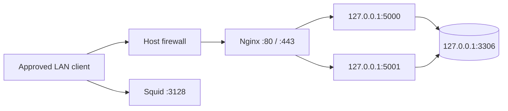

# Network, Squid, firewall and SSH assessment

## Network diagram



## Read-only commands

```bash
echo "=== UFW rules ==="
sudo ufw status verbose
echo
echo "=== Listening sockets ==="
sudo ss -lntup
echo
echo "=== Effective SSH settings ==="
sudo sshd -T | grep -Ei 'passwordauthentication|permitrootlogin|pubkeyauthentication|allowusers'
echo
echo "=== SSH service ==="
sudo systemctl status ssh --no-pager -l
echo
echo "=== Squid service ==="
sudo systemctl status squid --no-pager -l
echo
echo "=== Squid listener ==="
sudo ss -lntp | grep ':3128' || true
echo
echo "=== Squid ACL directives ==="
sudo grep -nE '^[[:space:]]*(acl|http_access|http_port)' /etc/squid/squid.conf
```

The assessment history reports prior inspection of Squid, firewall and SSH, but the latest assessment page did not retain all full raw output. Run these again and attach current output instead of fabricating historical results.

## Intended exposure matrix

| Port | Intended source |
|---|---|
| 22/tcp | Approved management host/subnet |
| 80/tcp | Lab clients; redirects to HTTPS |
| 443/tcp | Lab clients |
| 3128/tcp | Approved lab subnet only |
| 5000/5001 | Loopback only |
| 3306 | Loopback only |

## Functional Squid validation
From an authorized lab client, test one permitted destination and one intentionally denied destination. Record the command, status, source address, matched ACL and relevant access-log entry. Never configure or leave an open proxy.

## Safe firewall / SSH changes
Keep the current SSH session open and confirm console access. Validate with `sudo sshd -t` before reloading. Add intended allow rules before removing working rules, then verify with a second SSH session. Never blindly reset firewall rules over a remote connection. Do not commit private keys or secret-bearing config output.
